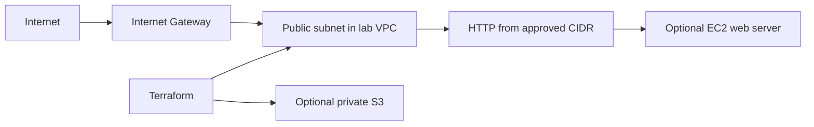

# Session 19: Cloud & Terraform in Action

Yash Agrawal · 24bcs10164

Source: [terraform](terraform). One VPC, subnet, Internet Gateway, route table/
association and scoped Security Group form the initial instructor network lab.
The optional create_compute phase adds an Amazon Linux Nginx EC2 instance and
private encrypted S3 bucket after the network works and costs are approved.
HTTP is restricted to the tester's CIDR, SSH is not opened, and IMDSv2 is required.

Providers call AWS APIs; variables parameterize resources; references create
dependencies; outputs expose selected results; state maps configuration addresses
to actual objects. A plan proposes changes, apply performs them, and destroy
removes managed resources. Protect state because it may contain sensitive data.

All HCL validates in CI. No plan/apply/service verification/AWS Console screenshot/
destroy has occurred. AWS execution is omitted at the student's request, leaving
those runtime rubric requirements unmet. Review the exact account and scoped resource inventory before
each apply/destroy; no account-wide cleanup commands are provided.

See [the completion audit](../../ASSIGNMENT-COMPLETION.md) for current execution and screenshot status.
